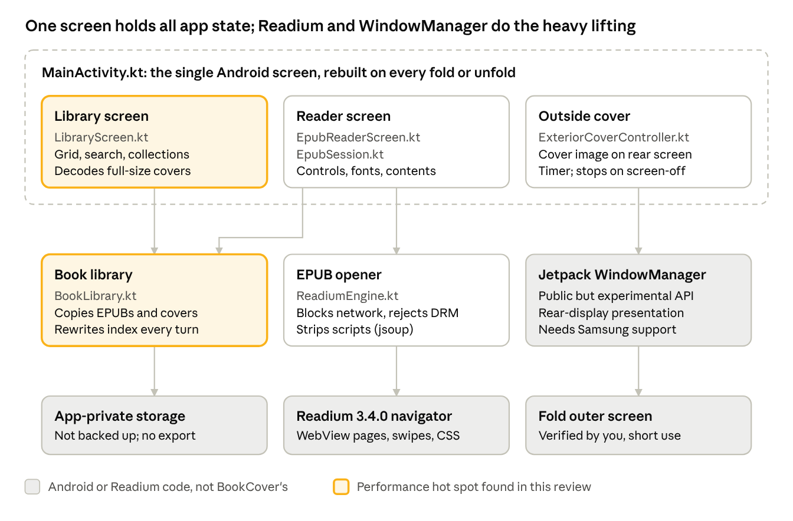
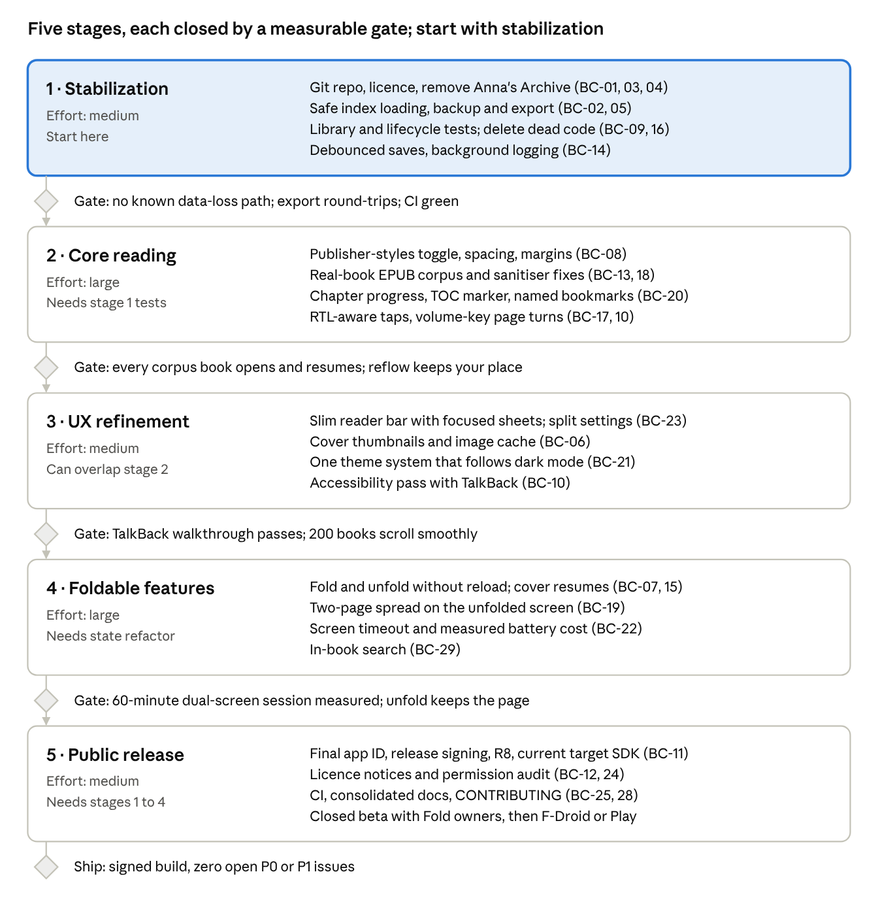

# Book Cover E-Reader — Expert Panel Review

Oct 26, 2026 · @Frank

## Completion tracker

Kept up to date by whoever finishes work (Claude Code, Codex, or the owner). The review text
below is the original, converted from `Expert Panel Review.docx`; only this tracker changes.

**How to update:** when an issue's acceptance criteria are met, set **Status** to `Done`, add
the commit, and say how it was verified (unit test, on-phone QA test, or the owner looking at
the phone). Use `In progress (who)` while working, and `Partial` when only part is finished. Commit
this file together with the change it records.

| ID | Pri | Issue | Status | Commit | Verified / notes |
| --- | --- | --- | --- | --- | --- |
| BC-01 | P0 | Remove Anna's Archive shortcut | Done | 1c6c414 | Owner confirmed the Settings button is gone |
| BC-02 | P0 | Unreadable index must not erase the library | Done | 6547b1c | `LibraryIndexTest`; backup file seen on phone |
| BC-03 | P0 | Project licence | Done | 04040c2 | Owner chose all rights reserved (`LICENSE`); no SPDX headers |
| BC-04 | P0 | Git history and private remote | Done | ac67f2a | Private repo github.com/zithal024-jpg/BookCover; baselines and APKs out of Git |
| BC-05 | P1 | Export / import library backup | Done | 5316eb7 | `LibraryBackupTest`; save and restore round trip on the owner's phone |
| BC-06 | P1 | Cover thumbnails and cache | Done | 0343325 | `CoverThumbnailTest`, `BookLibraryTest`; thumbnails made on phone. 200-book scroll speed not measured |
| BC-07 | P1 | Fold/unfold without reload | Partial | 55516e6 | Library flash hidden while reopening (owner confirmed). Still reloads the book and ends the cover session |
| BC-08 | P1 | Publisher styles, spacing, margins | Done — owner confirmed | 30e8bb3; fd7d50e, 75161e5 | Owner tested the installed update and confirmed "it works" on 2026-10-26. 51 JVM tests; `NativeReaderTest` 7/7 and unfolded `ReadingLayoutTest` 1/1 on phone. Publisher toggle restores poetry indents/fonts; custom spacing, margins and alignment persist and retain position within 2 paragraphs. Existing 800px cap retained. See `docs/BC-08-READING-COMFORT.md` |
| BC-09 | P1 | Library and lifecycle tests | Done | a67bc24 | `BookLibraryTest`, `ReaderLifecycleTest` (rotation, emulated fold, save on stop) |
| BC-10 | P1 | Accessibility, volume-key page turns | Done — owner confirmed | 8cd3a88; b3a5d75 | Owner confirmed the installed BC-10 build and requested completion on 2026-10-26. 91 JVM tests and 29/29 phone QA checks pass, none skipped; zero lint errors. Covers labeled 48dp controls, selected states, 200% text actions, optional volume turns, RTL-aware keyboard navigation, bookmarks, typography and lifecycle recovery. Installed in place without clearing app data; installed APK checksum matches the tested build. Formal TalkBack/Accessibility Scanner audit results are not separately recorded |
| BC-11 | P1 | Release build, final app ID | Open | | Needs the owner's decision on the final name and application ID |
| BC-12 | P1 | Font licence notices | Done — owner confirmed | 8d426c9; 6c3e730 | Owner checked the Licences screen on the phone and confirmed it on 2026-10-26. Correction: the bundled OpenDyslexic is v2.001, CC BY 3.0 over Bitstream Vera, not OFL. Library settings → About → Licences now lists every bundled licence with its full text: OpenDyslexic (CC BY 3.0 + Bitstream Vera), Readium (BSD 3-Clause), Readium comic-player scripts (MIT: PixiJS, resource-loader, Hammer.JS, punycode), AccessibleDfA and iA Writer Duospace fonts (SIL OFL 1.1, Readium's own notice files), jsoup (MIT), AndroidX/Compose/Kotlin/Guava and other runtime libraries (Apache 2.0), Java library desugaring (GPL v2 + Classpath Exception). Texts copied from the shipped or upstream files, not retyped. `BundledLicencesTest` (5) fails if a library in the build has no notice; Build.ps1 -TaskId ui: 108 JVM tests pass, zero lint errors. Not separately checked: TalkBack walkthrough; PixiJS, resource-loader and punycode full copyright lines not verified offline (MIT stated in bundled file) |
| BC-13 | P1 | Real-book EPUB test corpus | Done | ba93c4c | Owner chose generated books (no downloads): 28 in `EpubCorpus.kt`, run by `EpubCorpusTest` on phone: 22 open, show readable text, turn pages and reopen in place; 5 malformed or DRM books are rejected with the library unchanged; UTF-16 skipped as BC-18. Found and fixed: unknown-scheme encrypted EPUBs were imported (now rejected in `ReadiumEngine`). Not covered: real published books, 500-page search timing |
| BC-14 | P2 | Debounce saves, logging off main thread | Done | 976b573 | `LatestValueSaverTest`, `CoalescingWriterTest`; position survived a full app kill on phone. 1.5 s debounce; StrictMode not run |
| BC-15 | P2 | ViewModel / state out of MainActivity | Open | | One shared `BookLibrary` per process already (a67bc24) |
| BC-16 | P2 | Delete dead code | Done | 528e354 | Sample text moved to `scripts/lantern-keeper.txt` |
| BC-17 | P2 | RTL-aware edge taps | Done — owner confirmed with manga | 4db7ae2; 3a56e91 | Owner confirmed the corrected build works with manga on 2026-10-26. Passive image targets accept edge taps; inert Kindle panel anchors become passive spans. Combined build with BC-18's pending source: 61 JVM tests and 12/12 native reader checks pass, including artwork, overlays, swipes and real image links; zero lint errors. Installed `BookCover-BC17-image-fix.apk`. BC-18 resource-filter wiring must accompany the fix. See `docs/BC-17-DIRECTIONAL-EDGE-TAPS.md` |
| BC-18 | P2 | Sanitiser encodings, tag soup | Done | 3741061 | `PublicationMarkup` decodes by byte-order mark, UTF-16 byte pattern, XML declaration or meta charset, and re-labels output UTF-8 (6 new `PublicationMarkupTest` cases). Bigger finding: Readium 3.4.0 ignored the constructor hook, so the markup filter, including script stripping, never ran on the phone; it is now installed per open (see CLAUDE.md). `EpubCorpusTest`: UTF-16 book reads, book scripts no longer run. Full device suite 52/52; clean-checkout build and 61 JVM tests pass. Tag soup already rendered fine |
| BC-19 | P2 | Two-page spread when unfolded | Open | | |
| BC-20 | P2 | Chapter progress, TOC marker, named bookmarks | Done — owner confirmed core features | bd17106 | Owner confirmed Contents, bookmarks and chapter progress on 2026-10-26; reading-speed/time-left calibration remains TBD. Current Contents entry selected/scrolled into view; names preserve legacy bookmarks and prevent precise-target duplicates. RTL subsection jumps use public Readium locators. 85 JVM tests and 29 native QA checks pass; zero lint errors. APK installed in place. Physical outside-cover observation for this build remains unrecorded. See `docs/BC-20-READING-NAVIGATION.md` |
| BC-21 | P2 | One palette; Automatic follows dark mode | Done — owner confirmed | b18973f; 82bb729; d585f0d | Owner confirmed on 2026-10-26 on the phone: dark mode works, the pink cover now gives a pink accent, and the new colour themes look right. Automatic library theme follows the phone's light/dark setting; Paper/Forest/Midnight/Charcoal stay as chosen until Automatic is picked again. Reader control panels use the library's accent (the cover colour under Automatic), light over Paper/Sepia pages and dark over Night; page colours unchanged. Owner follow-up: pale or muted covers (e.g. pink) are now captured and shown with a clearly coloured accent of the same hue, and 11 colour themes (Rose, Crimson, Coral, Amber, Olive, Meadow, Teal, Ocean, Indigo, Lavender, Plum; follow dark mode; colour swatches in Settings) cover the whole colour wheel. Owner then saw a pink manga cover pick brown: its pinks were split over many shades and one flat brown patch outvoted them. Shades within 20 degrees of hue now vote together and the accent is their average (reproduced first with the cover's measured colour counts). `LibraryThemeModeTest` (6), `CoverHueTest` (6); committed Build.ps1 steps (lanes/bc21): 103 JVM tests pass, zero lint errors. Not separately checked: reader panels over each page colour, TalkBack reading of the new theme list |
| BC-22 | P2 | Screen-on timeout, battery measurement | Open | | |
| BC-23 | P2 | Split settings; hide diagnostics | Partial — settings split, owner confirmed; friendly messages done; accessibility/phone QA pending | 99c2777; e3826ed | Owner installed the build in place (library kept) and confirmed the grouped settings and hidden diagnostics on the phone on 2026-10-26. Library settings grouped into Appearance / Outside cover / Backup / About (`library/LibrarySettingsDialog.kt`, shared rows in `ui/SettingsRows.kt`); Device diagnostics hidden until 7 taps on the version line (memory only, owner-approved). Reader controls grouped into Text / Page turning / Page colour; all controls, labels and test tags unchanged. Build.ps1 (lanes/ui): 91 JVM tests, zero lint errors. Friendly status messages: see BC-26 (raw errors replaced; outside-cover status no longer shows Java error names). Pending: phone QA, TalkBack heading check, owner 10-second findability check |
| BC-24 | P2 | Permission audit | Open | | |
| BC-25 | P2 | CI and AGP 10 migration | Done — CI green; AGP 10 readiness migration complete | 27442c6; 9a0a99b (QA); 6743075 (install); 490b8d8 (owner); d1faaec (CI/migration); c6a785e (fixture fix); this commit (CI results) | Earlier guarded-tool integration was owner-confirmed after 68/68 live QA checks and all five manual checks, including the physically visible outside cover; installed APK checksum matched. This follow-up adds SHA-pinned GitHub Actions on push/PR/manual dispatch: clean Ubuntu build, JVM tests, both lint tasks, QA test-APK assembly and compiled QA-target verification; Windows PowerShell 5.1/Python host checks; read-only repository permissions and bounded report uploads. Removes both legacy AGP opt-out flags and kotlin.android plugin declarations, retaining AGP 9.3.3 and matching Kotlin/Compose compiler 2.4.20. Local validation: 138 JVM tests, no skips, zero lint errors (24 debug / 25 QA warnings); 49 resource + 18 orchestration + 26 packaging checks; actionlint and five manifest safety fixtures pass. Explicit strict modern-mode QA assembly targets only com.bookcover.diagnostic.qa. Workflow bytes are now frozen in source/evidence; workflow edits reject stale evidence. Real packaging --validate-only passes for source 0cf25413ca4288af. No phone operations/install in this follow-up; BUILD released. Owner authorized the private CI branch push. Hosted [CI run 40443053296](https://github.com/zithal024-jpg/BookCover/actions/runs/40443053296) is green on c6a785e: clean Ubuntu build/test/lint and QA assembly/manifest verification succeed; Windows passes 49 resource, 18 orchestration and 26 packaging checks, including the real 8.3 alias regression without skipping it. Downloaded Linux report artifact checksum verified: 138 tests, zero failures/errors/skips, zero lint errors; compiled manifest targets only the QA app. The first hosted run exposed a Windows 8.3 TEMP alias in a fixture; canonicalizing its root fixed it. The hosted CI acceptance gate is met. Google Maven has no AGP 10 artifact as checked 2026-10-26: the required built-in-Kotlin/modern-DSL readiness migration is validated on 9.3.3, not an unreleased AGP 10 binary. See docs/BC-25-TASK-RESOURCES.md |
| BC-26 | P3 | Friendly error messages | Partial — mapper and wiring done; phone check pending | e3826ed | `ReaderMessages.kt` maps each failure (by type and BookCover's own error texts, never by showing them) to a plain message for what the reader was doing: import, open, cover picture, backup save/restore, library start-up, collections, bookmarks. Covers corrupt/non-zip and truncated files, DRM, over 200 MB, no chapters, unreadable or missing files, wrong backup file, backup folder not writable, protected library list ("nothing was deleted"). The diagnostic log keeps action, reason and exception types without book or file names. Behaviour and data-safety guards unchanged. `ReaderMessagesTest` (9), including a scan that fails if library code throws a text with no specific message; Build.ps1 -TaskId ui: 117 JVM tests pass, zero lint errors. Pending: import a corrupt file and a non-backup file on the phone; `EpubCorpusTest` still logs the internal texts by design |
| BC-27 | P3 | Multi-select import, temp cleanup | Done — owner confirmed | 74ed155; fe9192e | Owner installed the tested build in place (library kept, installed APK checksum matches the tested one) and confirmed it works on 2026-10-27. Import EPUB now accepts many files in the system picker. Books import one at a time, each saved as soon as it is added, so a bad book never undoes the others or rewrites the library list; an unreadable library list stops the batch (nothing deleted). Progress (Importing book 3 of 20…, bar, Stop importing) and a final summary (imported / already in library / could not be imported, with file name and short reason); single-book messages unchanged. Overlapping imports refused. Stop keeps finished books and deletes the current copy. Start-up deletes only abandoned import-NUMBER.epub copies, never a running import (process-wide registry), books, covers, the library list or other files. Entries with unknown size are counted while reading and stopped at the existing 100 MB entry / 500 MB total limits; 20,000-entry and 200 MB file limits, SHA-256 duplicate check and Readium validation unchanged. Build.ps1 -TaskId bc27: 138 JVM tests pass, none skipped (new: ImportBatchTest 10, EpubArchiveCheckTest 7, ImportTempFilesTest 3, ReaderMessagesTest +1); zero lint errors. Test-Device.ps1 -TaskId bc27 (phone unfolded, unlocked): 7/7 QA tests pass, none skipped: BookImportBatchTest 6 (20-book batch, mixed bad/duplicate batch keeps existing positions and bookmarks, stop, overlap, killed-import cleanup, active copy kept), BatchImportActivityTest 1 (19 good + 1 broken book via the real screen: progress shown, summary correct, overlapping request refused, no import copies left). Owner hand check done. A rotation or fold during a batch stops it (books already imported are kept) |
| BC-28 | P3 | Consolidate documentation | Open | | |
| BC-29 | P2 | In-book search | Open | | |

Conversion note: in the original Word file the BC-07 row was split at the `|` characters inside
`screenSize|smallestScreenSize|screenLayout`, which pushed out that row's Size and Acceptance
criteria. The row below is rejoined; those two cells are marked as missing rather than guessed.

---

## Scope and method

This is a read-only audit of BookCover **0.4.0-prototype (version code 6)**. Nothing in the project was changed, built, or installed.

**What was inspected:** all 20 production Kotlin files (about 2,000 lines), all 8 unit-test files, the instrumented device test and its QA harness, Gradle build files, both manifests, resources, the 17 design and validation documents in docs/, the review package under review-deliverables/2026-10-26/, the recorded JUnit and lint results, the device logs, and the three phone screenshots in output/. The final APK was opened to check its contents (bundled fonts, licenses, dex size, merged-manifest strings).

**How:** source was read from the packaged review ZIP because the deepest source folders on your computer were too nested to copy directly. Every file checked against your live folder was byte-identical, and all 31 Kotlin file sizes match the live listing, so the findings apply to your current code.

**Limits — not verified here:**

- No build or test run was performed in this review. Test results quoted below come from the project's own recorded logs (October 26, 2026).
- No physical-device testing. Anything about the outside screen, folding, battery or real gesture feel relies on the project's logs and your own recorded observation.
- The three screenshots predate the 0.4.0 library-theme work (they show the stock Material purple), so current visual design is judged from code, not pixels.
- The test device reports itself as **Samsung SM-F976U, Android 17 (API 37)**. This review takes your word that it is the Galaxy Z Fold8 Ultra.
- Readium, WebView and Jetpack WindowManager internals were not audited; behavior attributed to them is marked as such.

Findings are labelled **Confirmed** (visible in code or test evidence), **Suspected** (follows from reading the code but not reproduced), **Design concern**, or **Enhancement**.

## Executive summary

**Verdict: a credible, well-tested proof of concept with one genuinely novel feature, but not yet a product.** It is ready for continued development and for personal daily use with backups. It is not ready for a public beta or store release; four release blockers come first.

BookCover began as a Kindle companion that would show a cover on the Fold's outside screen. Testing showed the cover stops when you switch to another app, so the project correctly pivoted to its own EPUB reader that keeps the cover alive. That pivot was the right call, and the core idea now works: you confirmed the outside cover stayed visible while you read, swiped and changed typography on 0.4.0.

**Biggest strengths**

- **A real, differentiating feature on public APIs.** The outside cover uses Jetpack WindowManager's rear-display presentation, a published Android library rather than a hidden Samsung trick (cover/ExteriorCoverController.kt).
- **The right rendering engine.** Readium 3.4.0 is the industry-standard open EPUB toolkit. Text size changes the document's CSS, so text truly reflows rather than zooming — proven by an on-phone test that measures glyph size, line count and image width.
- **Unusually honest engineering discipline.** Tests run in a separate QA app, results distinguish human observation from API callbacks, and limitations are documented candidly.
- **Privacy by construction.** The app has no internet permission and blocks remote book resources in code (library/ReadiumEngine.kt:25).

**Biggest weaknesses**

- **Release blockers:** a built-in shortcut to search Anna's Archive (a shadow library of pirated books), no project license, no committed version history, and a code path that can wipe the library index if it fails to load.
- **Thin reading feature set.** Typography stops at size and three fonts; publisher styling is always overridden; there is no in-book search, highlights, line-spacing or margin control, chapter progress, or volume-key page turns.
- **Not yet foldable-native.** Folding or unfolding destroys and rebuilds the whole screen and ends the cover session. The unfolded screen shows one narrow column, not a two-page book spread.
- **Will not scale past a small library.** Every cover is decoded at full resolution for each grid tile, and every page turn rewrites the whole library file and the diagnostic log.

**Most important conclusion:** the gap to a competitive reader is mostly product depth and robustness, not architecture. No rewrite is needed. The single most valuable direction is to lean into the vision — *make an unfolded Fold feel like a physical book*: cover outside, a two-page spread inside, seamless fold/unfold continuity — while closing the release blockers and the data-safety gaps first.

## Current product inventory

Of 23 capabilities checked, 10 are verified on the phone, 7 are implemented but only code-checked, 2 are partial, 2 are missing, and 2 exist only as unused code. "Verified" means a recorded device test or your own observation; "Implemented" means the code exists and looks correct but no device evidence covers it.

| Capability | Status | Evidence |
| --- | --- | --- |
| Import DRM-free EPUB from Files | Verified | BookLibrary.import; four-book library restored and opened on device (RESULTS.md) |
| Duplicate detection by file fingerprint | Implemented | SHA-256 of file bytes (BookLibrary.kt:83) |
| Paginated EPUB reading with swipe | Verified | 5/5 native tests folded and unfolded (tests/native-qa, tests/folded-1) |
| True text reflow on size change (80–220%) | Verified | Test measures larger glyphs, more lines, unchanged viewport and image width |
| Serif / Sans / OpenDyslexic fonts | Verified | Test confirms the OpenDyslexic font face actually loaded |
| Position kept after text-size change | Verified (approximate) | Test asserts within 2 paragraphs of the start point |
| Reading position saved and restored | Verified | Saved on every page turn; reopening and cold restart exercised in 0.3.0 |
| Optional edge-tap page turns | Verified | Off by default; links and text selection are not hijacked |
| Fixed-layout EPUB detection | Verified | Typography controls disable themselves |
| Paper / Sepia / Night reading themes | Implemented | EpubSession.kt:215; no 0.4.0 screenshot |
| Table of contents and bookmarks | Implemented | EpubReaderScreen.kt:78–101; bookmarks are unnamed |
| Library search, sort, collections | Implemented | LibraryScreen.kt:40–45; collections are free-text |
| Library theme from latest cover + manual themes | Verified | Device colour samples and persistence logged (library-theme-phone-tests.txt) |
| Outside cover while reading | Verified (short sessions) | Your confirmation on 0.3.0 and 0.4.0; long-duration and battery not measured |
| Outside cover auto-start and 30/60/manual timer | Implemented | ExteriorCoverController.start; timer only logged in 0.2 era |
| Replace a book's cover image | Implemented | BookLibrary.replaceCover |
| Outside cover across fold/unfold | Partial | Activity is rebuilt; cover session ends and must restart (KNOWN-LIMITATIONS.md) |
| Accessibility (TalkBack, large fonts) | Partial | Some labels exist; no TalkBack or font-scale testing recorded |
| Local diagnostics log | Implemented | DiagnosticLog.kt; exposed in Settings |
| Release build, signing, store packaging | Not implemented | Debug key only; no minification; 56.7 MB APK |
| Backup / export of library and progress | Not implemented | Documented as debt; one real data loss already occurred during testing |
| Outer-screen brightness control | Unused code | OuterBrightnessControl.kt is never called; shelved after it did not work |
| Built-in sample reader (pre-EPUB) | Unused code | SampleReaderScreen.kt, SampleBook.kt, SampleReadingPosition.kt — about 390 lines, never reached |

**Not present at all:** PDF, MOBI/AZW, comics, OPDS catalogs, cloud sync, highlights and notes, in-book search, dictionary lookup, text-to-speech, page numbers or time-left, scroll mode, two-page spreads, brightness or warmth control, volume-key navigation.

## Multidisciplinary assessment

The panel agrees on one thing: BookCover's idea is distinctive, but today it competes with free, mature readers (Moon+ Reader, ReadEra, Librera, KOReader) on reading depth, where it is far behind. Its path is to win on foldables, not on feature count.

### Product management

- **Vision is clear but narrow.** "Your books, inside and out" only pays off on a foldable with a rear-display mode, and only while you read inside BookCover. On a normal phone it is a basic EPUB reader.
- **Target user:** a Fold owner who reads DRM-free EPUBs and enjoys the physical-book feel. Kindle readers — the original target — cannot use it, because Kindle books are DRM-protected and the cover dies when Kindle is in front.
- **Onboarding is good for a prototype.** Two original sample books install on first launch, and the empty state tells you to import a DRM-free EPUB.
- **Scope creep to remove:** the Anna's Archive shortcut (legal liability, see BC-01), the user-facing "Device diagnostics" dialog, and diagnostic language in status messages ("same host activity").
- **Minimum for a public beta:** release blockers closed, backup/export, line-spacing and margin controls, a publisher-styles toggle, chapter progress, volume-key turns, and stable fold/unfold behaviour.
- **Best differentiation, low cost:** a two-page spread on the unfolded screen (Readium already supports two columns), the cover outside, and seamless reading continuity when folding.

### Reading experience

**Typography — correct mechanism, narrow controls.** Size changes go through Readium's CSS (useReadiumCssFontSize = true, EpubSession.kt:76) and the device test proves real reflow. Line height (1.5), margins, paragraph spacing and indent are hard-coded (EpubSession.kt:213). publisherStyles = false is always on, so a book's own styling — poetry indents, centred epigraphs, small caps, drop caps — is overridden for every book, with no way to turn it back on.

**Pagination and gestures — conservative and safe.** Swipes are Readium's native handler. The centre half of the screen opens controls; optional edge taps use a band of at most 32 dp (about 5 mm) and are off by default (ReadingTapPolicy.kt:14). This avoids accidental turns but means tapping the right third of the page does nothing, which surprises users of most readers. Edge taps map left = back, right = forward regardless of book direction, which is likely wrong for right-to-left books (Suspected, BC-17).

**Rendering and compatibility.** Every XHTML/SVG resource is parsed and re-serialised through jsoup to strip scripts and active content (PublicationMarkup.kt). This is a sound safety choice, but it decodes all files as UTF-8 and runs an XML parser over them, which can mangle UTF-16 or malformed HTML books (Suspected, BC-18). Only two generated samples and one test fixture have been run; no real-world EPUB corpus (EPUB 2, RTL, tables, embedded fonts, large files) has been tested.

**Progress and navigation.** Only a whole-book percentage in 11 sp grey text. No chapter progress, pages left, time left or page numbers. The table of contents is a flat list with no current-chapter marker; bookmarks are labelled by percentage and cannot be named.

### Foldable and outside-cover feature

- **API footing is sound.** WindowAreaController.presentContentOnWindowArea is a public Jetpack WindowManager 1.5.1 API, marked *experimental* (@ExperimentalWindowApi), so its shape may change. Availability depends on Samsung's vendor extension, which the code checks at runtime and degrades gracefully: on other phones the cover button is simply disabled.
- **Verified:** short sessions on the target phone, by your direct observation. **Not verified:** sessions over 10 minutes, battery or heat, screen-burn behaviour, lock/unlock, and fold/unfold permutations.
- **Lifecycle gap.** The manifest declares no configChanges, so every fold, unfold, rotation or dark-mode switch destroys MainActivity, closes the book and the cover session, then reopens from the saved position (MainActivity.kt:64, 119, 178). Position survives; the cover does not, and reopening a large book recomputes its position list each time.
- **Unfolded layout is under-used.** The reader is forced to one column (ColumnCount.ONE). On the near-square inner screen that is a narrow centred column with wide margins (see BookCover-reader-epub.png).
- **Outside cover presentation is well done:** the image is fit-to-screen with a background colour matched to the cover's edges, so letterboxing looks intentional (BookCover-exterior-epub.png).

### Accessibility and ergonomics

- **Good:** library theme colours are mathematically contrast-tested against 257 random and extreme cover colours (text ≥ 4.5:1, borders ≥ 3:1). Most controls are text buttons with readable labels; key icon-like buttons have descriptions.
- **Gaps:** the book-card menu button is 32 dp wide (Android's minimum is 48 dp) and is read by TalkBack as "vertical ellipsis". Selected sort and theme states are shown with "•" and "✓" characters rather than accessible selected-state semantics. No volume-key or keyboard page turning, which matters for one-handed and motor-impaired reading. No TalkBack, switch-access or large-font testing is recorded, and paginated WebView readers are notoriously hard for screen readers.
- **Ergonomics:** controls sit in a tall bottom panel that can cover 75% of the screen; on the unfolded screen the top-left Library button is a long reach one-handed.

### Performance and reliability

Nothing has been measured — no startup time, book-open latency, memory or battery figures exist in the project. Code reading points to three likely hot spots:

1. **Library covers** are decoded at full 1080×1600 resolution for every visible tile, about 6.9 MB of memory each, with no cache (LibraryScreen.kt:81, BookLibrary.kt:143). Fifteen visible tiles on the unfolded screen is roughly 100 MB.
1. **Every page turn** writes the entire library index to disk (BookLibrary.kt:104) and synchronously rewrites the diagnostic log file (up to 128 KB) on the main thread (EpubSession.kt:122 → DiagnosticLog.kt:77).
1. **Every chapter load** re-parses its HTML through jsoup before display.

Reliability strengths: atomic writes for the index and covers, import size and zip-bomb limits, bounded log size, and careful cancellation handling in the typography code.

## Technical architecture review

**The architecture is small, coherent and fit for a prototype; it needs restructuring, not replacement.** About 2,000 lines of Kotlin sit on top of Readium and Jetpack, which do the hard work.

BookCover 0.4.0 architecture · 6 app parts, 4 platform parts

Every part writes to DiagnosticLog.kt (not drawn), which is the second page-turn hot spot.

### Strengths worth preserving

- **Right dependencies, pinned versions.** Readium 3.4.0 (BSD-3), AndroidX/Compose via a BOM, jsoup; Gradle wrapper with a SHA-256 checksum; FAIL_ON_PROJECT_REPOS repository policy (settings.gradle.kts:9).
- **Pure logic split out and tested.** Tap zones, text-size rounding, cover-colour extraction and palette contrast are plain functions with JVM tests (ReadingTapPolicy.kt, ReadingTypography.kt, CoverPalette.kt).
- **Safe file handling.** Books are copied into app-private storage and named by SHA-256, so IDs cannot become file paths (BookRecord.kt:28); index and cover writes use AtomicFile; imports are capped at 200 MB with zip-bomb limits (BookLibrary.kt:73–81).
- **Thoughtful navigator restoration.** Readium cannot be rebuilt by Android's fragment restorer, so the app deliberately reopens from its own saved locator (MainActivity.kt:62–64). This is the correct workaround.
- **Isolated device tests.** A separate qa build type with its own application ID keeps instrumentation from touching your real library (app/build.gradle.kts:21–29).

### Weaknesses and technical risks

| Risk | Evidence | Consequence | Remedy |
| --- | --- | --- | --- |
| Library index failure overwrites the library (data loss) | BookLibrary.load throws on any bad JSON or any one invalid record (BookLibrary.kt:46–48, BookRecord.kt:28); the list stays empty and the next save writes only the new change (BookLibrary.kt:97, 146) | One corrupt line, or a future schema change, silently erases every title, position and bookmark | Refuse all writes until a successful load; skip bad records individually; keep a dated backup (BC-02) |
| All state lives in the Activity | MainActivity.kt:35–43 holds session, busy flag, messages, theme, timers; no ViewModel | Every fold rebuilds the screen and closes the book and cover; logic is untestable without a device | Move session and library state into a ViewModel or app-scoped holder; declare fold-related configChanges (BC-07, BC-15) |
| One shared busy flag for all background jobs | MainActivity.kt:161–170 | The first job to finish re-enables buttons while another is still running | Track jobs individually or serialise them (BC-15) |
| Writes on every page turn | EpubSession.kt:121–122; DiagnosticLog.kt:77 runs on the main thread | Jank and battery cost that grow with library size | Debounce position saves; move logging to a background writer (BC-14) |
| Full-size cover decoding, no cache | BookLibrary.kt:143, LibraryScreen.kt:81 | Memory and scroll jank with dozens of books | Store a thumbnail at import; use an image cache (BC-06) |
| Unconditional HTML re-serialisation | PublicationMarkup.kt:8 decodes UTF-8 and uses an XML parser | Possible garbled or broken chapters in UTF-16 or sloppy-HTML books | Detect encoding; fall back to the original bytes if parsing fails (BC-18) |
| Experimental display API | @OptIn(ExperimentalWindowApi::class), ExteriorCoverController.kt:54 | A WindowManager update can break the cover feature | Pin the version; wrap it behind an interface; add a smoke test (BC-07) |
| About 22% dead code | Sample reader, brightness control, DisplayPolicy.kt, Kindle <queries> in the manifest | Confuses contributors; tests cover code users never reach | Delete; keep history in Git, not in docs/baselines (BC-16) |
| Prototype identity baked in | applicationId = "com.bookcover.diagnostic" (app/build.gradle.kts:11) | Cannot be changed after store release without losing users' data | Choose a final ID before any public build (BC-11) |
| Build tied to this computer | LOCALAPPDATA OneDrive workaround (build.gradle.kts:10–17); AGP 9 legacy flags (gradle.properties:5–6); no CI | Contributors on macOS/Linux get different behaviour; AGP 10 will break the build | Add CI on Linux; migrate the DSL flags (BC-25) |

**Can it grow without a rewrite?** Yes, with targeted changes. More formats: Readium already parses PDF and audiobooks; ReadiumEngine would need a PDF factory and EpubSession generalised to a ReaderSession interface. Larger libraries: replace the single JSON file with Room (Android's standard local database) once past roughly a few hundred books. Foldable features: Readium supports two columns, and WindowManager exposes fold posture; both slot into the existing structure once state leaves the Activity.

## UI/UX review

**The interface is clean and calm, but it is a phone layout stretched onto a tablet-sized screen, and its settings are a junk drawer.** Visual conclusions below come from the 0.3.0-era screenshots plus 0.4.0 code; the new library themes need fresh screenshots before final judgement.

### Home library

- **Covers lead, correctly.** A 145 dp adaptive grid with real artwork, title, author, collection and percentage is the right foundation (LibraryScreen.kt:77–104).
- **Too much chrome above the books.** On the unfolded screen the title, search field, collection chips, sort row, status message and Continue button take about 40% of the height before the first cover (BookCover-library.png). On the folded outer screen this will be worse. Recommend: collapse search into an icon, merge sort into a menu, drop the status line except for errors, and let the header scroll away.
- **Continue reading is a text pill** ("Continue · The Lantern Keeper · 0%"). A cover-plus-progress-bar card would be far more inviting and is the most-used action in any reader.
- **Inconsistent cover framing.** Covers with non-standard ratios are letterboxed on a grey tile (the Dresden Files omnibus). Use the same matched-edge-colour trick already used on the outside screen.
- **Progress is a number only.** A thin progress bar under each cover scans faster than "Books · 19%".
- **Missing states:** no import-in-progress indicator per book, no undo after Remove, no multi-select, and errors appear as raw text in the status line.

### Dynamic library theme

**Keep it, but tone it down and make it follow dark mode.** Deriving the accent from the latest cover is a charming, on-brand touch, and the contrast safeguards are excellent (CoverPalette.kt:71–106, tested across 257 colours). Two problems remain:

- **Automatic is always light.** It ignores the phone's dark-mode setting, so a night reader opening the app at 11 pm gets a near-white screen.
- **Two separate theme systems.** The reader's top and bottom control panels use stock Material light/dark colours (EpubReaderScreen.kt:42), so they are the default Material purple whatever the library theme is. Reader chrome should share the library palette.

Recommendation: "Automatic" = follow system light/dark, tinted by the cover; keep Paper/Forest/Midnight/Charcoal as overrides.

### Reader

- **Immersive by default, good.** System bars hide, controls appear on a centre tap, and a small completion percentage sits bottom-left (BookCover-reader-epub.png).
- **The control panel is a long scroll of everything.** Outside-cover status, start/stop, contents, bookmark, size buttons, slider, three font chips, edge-tap switch, three themes, choose cover, previous/next and Resume all stack in one panel up to 75% of the screen (EpubReaderScreen.kt:102–156). Readers expect a slim bottom bar with 4–5 icons (Contents, Aa, Theme, Bookmark, Cover) that each open a focused sheet.
- **Redundant and leaked controls.** "Previous/Next" buttons duplicate swipes; "Read" and "Resume reading" do the same thing; the raw status message (including outside-cover diagnostics) is shown to the reader.
- **Text-based state marks.** "✓ Paper", "• Recent" and "A− / A+" are typographic hacks; use real selected-state components and icons.

### Settings

The library Settings dialog mixes seven unrelated things: library theme, outside-cover auto-start, cover timer, a gesture tip, the Anna's Archive link, device diagnostics and the version string (LibraryScreen.kt:116–141). Split into **Appearance**, **Outside cover**, **Reading defaults** and **About** (licences, version, diagnostics hidden behind a long-press or developer toggle).

### What needs screenshots or hands-on testing

Folded outer-screen library layout; 0.4.0 library themes in light and Midnight; reader control sheet at 200% system font size; landscape on the inner screen; TalkBack walkthrough of import → open → turn page → bookmark.

## Quality and release-readiness

**Quality practice is ahead of most prototypes; release engineering, licensing and data safety are not started.**

### Testing and reliability

| Suite | Tests | Last recorded result | What it covers |
| --- | --- | --- | --- |
| JVM unit tests | 24 | 24/24 pass (Oct 26, 2026) | Tap zones, text-size bounds, fonts, cover colours, palette contrast, record JSON, markup stripping, unused sample pagination |
| On-phone instrumented (folded) | 5 | 5/5 pass | Real reflow, font persistence and OpenDyslexic loading, edge taps vs swipes vs links, selection, fixed layout |
| On-phone instrumented (unfolded) | 5 | 5/5 pass | Same tests |
| Android lint | — | 0 errors, 22–23 warnings | Mostly style suggestions; one real warning: targetSdk 35 is out of date |

**Biggest coverage gaps**, in the order they should be closed:

1. BookLibrary — import, duplicate detection, corrupt index, remove, cover replacement. This is where user data lives and it has zero tests.
1. Lifecycle — fold/unfold, rotation, process death, reopening at the saved locator.
1. ExteriorCoverController state machine — start/stop races, timer, screen-off, activity destroyed mid-start (testable with a fake controller).
1. A real-world EPUB corpus — EPUB 2 and 3, RTL, tables, footnotes, embedded fonts, a 100 MB+ book, malformed files.
1. Performance baselines — cold start, book open, page-turn frame times, memory with 100 books (Android Macrobenchmark).

**Recorded data-loss incident.** During this cycle, a test run uninstalled the main app and erased the library's positions and bookmarks. It was handled well — disclosed, books restored, tests isolated into a .qa app — but it is real evidence that users need backup/export before wider use.

### Security and privacy

- **Strong:** no INTERNET permission in the merged APK manifest; remote book resources fail by design (ReadiumEngine.kt:25–28); book scripts, iframes, forms and javascript: links are stripped; cloud backup and device transfer are disabled (data_extraction_rules.xml); the cover-screen receiver is not exported; the diagnostic log scrubs content:// and file:// paths.
- **To verify:** the merged manifest also references WAKE_LOCK, ACCESS_NETWORK_STATE and a Media3 Bluetooth component, almost certainly pulled in by Readium's audio support. Check with aapt dump permissions and remove unused ones with tools:node="remove".
- **Minor:** the log records device fingerprint and reading percentages locally. Fine for a prototype, but disclose it in a privacy note.
- **Trade-off to document:** disabling backup protects privacy but means a phone reset loses every position and bookmark. Pair it with an explicit export.

### Licensing and legal

| Item | Status | Risk |
| --- | --- | --- |
| Project licence | **Missing** — no LICENSE file | Legally "all rights reserved"; nobody may reuse or contribute. Release blocker |
| Anna's Archive shortcut | Present in Settings and MainActivity.kt:88–90 | Directs users to a shadow library; likely violates Google Play policy and invites DMCA trouble for a public repo. Release blocker |
| Readium (BSD-3) | Licence text shipped in assets/READIUM-LICENSE.txt | OK |
| OpenDyslexic font | Font ships in APK (assets/readium/fonts/OpenDyslexic-Regular.otf) **with no licence file**, unlike the two other bundled fonts | Verified absence; its SIL Open Font Licence requires the licence to travel with the font. Add it plus an About → Licences screen |
| AndroidX, Compose, jsoup | Licence files embedded in META-INF | OK, but no user-visible notices screen |
| Sample books and covers | Original works generated by scripts/GenerateSamples.py | OK |
| Your personal books | Kept out of review archives on purpose | OK; keep them out of the public repo and screenshots |

### Distribution and open-source readiness

- **Not ready.** Only a debug build signed with a local debug key; no release build type, no R8 shrinking (the APK is 56.7 MB, mostly unshrunk code), targetSdk 35, and a permanent-looking com.bookcover.diagnostic application ID.
- **No version history.** The .git folder exists but has **zero commits**; every file is untracked (changes/GIT-STATE.txt). The project lives only in a OneDrive folder, plus a hand-made baseline ZIP.
- **Documentation is thorough but layered.** The README stacks three versions of history in collapsible sections; 20+ Markdown files overlap. A contributor needs one README, one CONTRIBUTING.md, one ARCHITECTURE.md and a changelog.
- **Build reproducibility:** pinned versions and a checksummed Gradle wrapper are good. A clean-extraction build passed on your PC, but it has never run on Linux or macOS and there is no CI.

## Product scorecard

**Overall maturity: 4/10 — an advanced prototype.** The category average is about 5, but the overall score is held lower on purpose: four release blockers and an unprotected library would stop any public release regardless of strengths elsewhere.

| Category | Score | Justification |
| --- | --- | --- |
| Security and privacy | 8/10 | No internet permission, scripts stripped, backup disabled, private storage, scrubbed logs. Merged-manifest permissions still need an audit |
| Product vision and differentiation | 6/10 | A genuinely novel outside-cover experience on public APIs; narrow audience; the original Kindle use case proved impossible |
| Software architecture | 6/10 | Small, readable, well-chosen dependencies; all state in one Activity, no ViewModel, a shared busy flag, 22% dead code |
| Test coverage and maintainability | 6/10 | Excellent real-device rendering and gesture tests; zero tests on library persistence or lifecycle; no committed history |
| Typography and rendering | 5/10 | True CSS reflow proven on device; only size and three fonts; publisher styles always overridden; no real-book corpus tested |
| Navigation and ergonomics | 5/10 | Safe, conflict-free gestures; no volume-key turns; tall control panel; narrow off-by-default edge zones |
| UI/UX and visual design | 5/10 | Clean, cover-led, contrast-safe themes; header-heavy library, overloaded settings, two theme systems, no dark-mode follow |
| Core reading functionality | 4/10 | Open, read, resume, contents and bookmarks work; no search, highlights, chapter progress, spacing or margin controls |
| Performance and reliability | 4/10 | Reliability judged only: atomic writes and limits are good, but one real data loss occurred and an index-wipe path exists. **Performance: Not Assessed** — nothing measured |
| Accessibility | 3/10 | Contrast tested and some labels present; sub-48 dp targets, text-character state marks, no key navigation, no TalkBack testing |
| Open-source readiness | 2/10 | No licence, no commits, piracy shortcut, missing font licence, debug-only build; good docs and pinned build help |
| **Overall product maturity** | **4/10** | Ready for continued development and personal use with backups; not ready for public beta |

## Prioritized issue register

**29 findings: 4 P0, 9 P1, 13 P2, 3 P3.** Kind: **Defect** = confirmed in code or evidence; **Suspected** = follows from reading the code, not reproduced; **Design** = works as built but is the wrong choice; **Enhancement** = new capability. Size: S ≈ a day or less, M ≈ a few days, L ≈ a week or more of focused work.

| ID | Priority | Discipline | Kind | Problem and evidence | Impact | Recommended fix (and regression risk) | Size | Acceptance criteria |
| --- | --- | --- | --- | --- | --- | --- | --- | --- |
| BC-01 | P0 | Legal / Product | Design | Settings offers "Anna's Archive · browser search" (LibraryScreen.kt:137, MainActivity.kt:88–90) | Steers users to a shadow library; Play policy and DMCA exposure for you and the repo | Remove the shortcut and its strings. Optionally link to legal DRM-free sources (Standard Ebooks, Project Gutenberg). No regression risk | S | No reference to Anna's Archive in source, strings or docs; app builds and Settings opens |
| BC-02 | P0 | Engineering | Suspected | Index load failure leaves an empty list; next save overwrites books.json (BookLibrary.kt:46–48, 97, 146; BookRecord.kt:28) | Silent loss of every title, position and bookmark | Track a loaded flag and refuse writes until load succeeds; skip bad records individually; keep books.json.bak with the last good copy; tell the user. Risk: low | S | Unit test: corrupt index → no write occurs, error shown; one bad record → other books still load |
| BC-03 | P0 | Open source | Defect | No LICENSE file anywhere in the project | No one can legally reuse or contribute | Choose a licence compatible with BSD-3 Readium (Apache-2.0 or GPL-3.0 are common for readers); add SPDX headers | S | LICENSE at repo root; README states it; licence compatible with all dependencies |
| BC-04 | P0 | Engineering | Defect | .git has zero commits; all files untracked (changes/GIT-STATE.txt); source lives only in OneDrive | One bad edit or sync conflict can lose work with no history; no basis for contributions | Commit current state; push to a private GitHub repo; move baselines and APKs out of the tree | S | Remote repo exists; main builds from a fresh clone; docs/baselines and output/*.apk not in Git |
| BC-05 | P1 | Product / Engineering | Design | No backup or export; cloud backup deliberately disabled (data_extraction_rules.xml) | A reset, reinstall or test mistake loses all progress (already happened once) | Export/import of books.json plus bookmarks via the system file picker; optional auto-export to a chosen folder | M | Export, uninstall, reinstall, import → same positions and bookmarks |
| BC-06 | P1 | Performance | Defect | Grid decodes each 1080×1600 PNG at full size per tile, uncached (LibraryScreen.kt:81, BookLibrary.kt:143) | ~6.9 MB per visible cover; jank and memory pressure at 50+ books | Save a ~300 px thumbnail at import; decode with inSampleSize; add an LRU cache or Coil. Risk: cover-replace path must refresh the thumbnail | M | 200-book library scrolls at 60 fps on the Fold; heap stays under 150 MB |
| BC-07 | P1 | Foldable / Engineering | Design | No configChanges; fold/unfold destroys the Activity, closes book and cover (MainActivity.kt:64, 178) | Core foldable moment is a reload; cover must be restarted; large books re-index | Move session to a ViewModel; handle `screenSize\|smallestScreenSize\|screenLayout` *(rest of this cell was lost in the original document)* | *(missing in original)* | *(missing in original)* |
| BC-08 | P1 | Reading | Design | publisherStyles = false always; line height, margins, spacing, indent hard-coded (EpubSession.kt:211–216) | Books lose authored formatting; users cannot tune comfort | Add "Publisher styles" toggle (default on), plus line spacing, margins and justification. Risk: re-run reflow tests | M | Toggle restores a poetry fixture's indents; each control reflows and keeps position within 2 paragraphs |
| BC-09 | P1 | QA | Defect | No tests for BookLibrary, lifecycle or ExteriorCoverController | The riskiest code is unprotected | Add JVM tests with a temp dir; instrumented fold/rotation and process-death tests in the QA app | M | Tests cover import, duplicate, remove, corrupt index, cover replace, rotation, process death |
| BC-10 | P1 | Accessibility | Defect | 32 dp menu button with "⋮" text (LibraryScreen.kt:96); state shown by "•"/"✓"; no volume or keyboard page turns; no TalkBack testing | Barriers for screen-reader, low-vision and motor-impaired users | 48 dp icon buttons with labels; selected semantics; volume-key and keyboard turns (Readium DirectionalNavigationAdapter); TalkBack audit | M | Accessibility Scanner shows no target-size or label issues; TalkBack can import, open, turn pages and bookmark |
| BC-11 | P1 | Release | Defect | Debug signing only; no release build type, no R8; 56.7 MB APK; targetSdk 35; ID com.bookcover.diagnostic | Cannot be published; huge download; permanent prototype name | Pick the final application ID; add release build with R8 and Readium keep rules; target current SDK; set up a release key (kept off the repo) | M | Signed release APK/AAB under ~15 MB passes all device tests; new ID installs alongside the prototype |
| BC-12 | P1 | Legal | Defect | OpenDyslexic-Regular.otf ships with no licence file; no in-app notices | Font licence non-compliance at publication | Add OFL text to assets; About → Licences screen (e.g. Google's oss-licenses plugin) | S | APK contains OpenDyslexic licence; About lists every bundled licence |
| BC-13 | P1 | QA / Reading | Defect | Only two generated samples and one fixture tested | Unknown failures on real books | Build a corpus of 20–30 public-domain and test EPUBs (EPUB 2/3, RTL, CJK, tables, footnotes, embedded fonts, 150 MB, malformed); automated open-and-paginate smoke test | M | Every corpus book opens, paginates, resumes; failures produce a friendly message |
| BC-14 | P2 | Performance | Defect | Each page turn rewrites the full index and, on the main thread, the whole diagnostic log (EpubSession.kt:121–122, DiagnosticLog.kt:77) | Avoidable jank and battery drain | Debounce position saves (e.g. 2 s and on pause); move logging to a background append-only writer; log less | S | StrictMode shows no main-thread disk writes while reading; index written at most once per 2 s |
| BC-15 | P2 | Engineering | Design | MainActivity owns all state; one shared busy flag (MainActivity.kt:35–43, 161–170) | Hard to test; buttons re-enable early during overlapping jobs | Introduce a ViewModel and a small repository layer; per-operation state | M | Logic unit-testable without a device; concurrent import + open cannot re-enable controls early |
| BC-16 | P2 | Engineering | Defect | ~440 lines unused: SampleReaderScreen.kt, SampleBook.kt, SampleReadingPosition.kt, OuterBrightnessControl.kt, DisplayPolicy.kt; Kindle <queries> in manifest; docs/baselines/*.kt | Contributor confusion; tests on dead code | Delete after BC-04 so history keeps them | S | No unreferenced Kotlin files; test count drops only by the removed suites |
| BC-17 | P2 | Reading | Suspected | Edge taps map left = back, right = forward for every book (EpubSession.kt:105–106) | Likely inverted for Arabic, Hebrew, manga-style RTL books | Map by the publication's reading progression | S | RTL fixture: left-edge tap advances |
| BC-18 | P2 | Rendering | Suspected | Sanitiser decodes every resource as UTF-8 and re-serialises with an XML parser (PublicationMarkup.kt:8, 25) | Garbled UTF-16 books; malformed HTML may break | Honour declared encoding; on parse failure fall back to original bytes with scripts blocked by CSP | S | UTF-16 and tag-soup fixtures render identically to an unsanitised copy minus scripts |
| BC-19 | P2 | Foldable / Product | Enhancement | Reader forced to one column (ColumnCount.ONE); library header eats ~40% of height | Unfolded screen does not feel like a book | Two-page spread when unfolded and landscape-wide (Readium ColumnCount.AUTO/TWO), respecting the hinge; compact scrolling header | M | Unfolded: two pages side by side, no text under the hinge; folded: single column |
| BC-20 | P2 | Reading | Enhancement | Whole-book % only; TOC has no current-chapter marker; bookmarks unnamed and duplicate-prone | Users cannot gauge chapter length or find their place | Chapter progress and time left; highlight current TOC item; named bookmarks with chapter title | M | Reader shows chapter progress; TOC opens scrolled to current chapter |
| BC-21 | P2 | Design | Design | Reader chrome uses stock Material colours (EpubReaderScreen.kt:42); Automatic library theme ignores system dark mode | Visual inconsistency; bright screen at night | Share one palette; Automatic follows system light/dark | S | Dark-mode phone opens a dark library; reader panels match library accent |
| BC-22 | P2 | Power / HCI | Design | FLAG_KEEP_SCREEN_ON for the whole reading session on both screens (MainActivity.kt:153, ExteriorCoverController.kt:121) | Drain and OLED burn-in risk if left open | Configurable inner-screen timeout; measure cover-screen drain; consider subtle cover shifting | S | Inner screen sleeps after the chosen idle time; a 60-minute drain figure is recorded |
| BC-23 | P2 | UX | Design | Settings dialog mixes seven concerns; diagnostics and status messages visible to readers (LibraryScreen.kt:116–141; MainActivity.kt:95) | Confusing; looks unfinished | Split settings into sections; hide diagnostics behind a developer toggle; user-friendly messages only | M | Usability test: 5 of 5 users find text size and cover timer in under 10 s |
| BC-24 | P2 | Security | Suspected | Merged manifest references WAKE_LOCK, ACCESS_NETWORK_STATE, Media3 Bluetooth component | Unexplained permissions erode trust in a privacy-first app | Run aapt dump permissions; remove unneeded ones with manifest merger rules | S | Release manifest lists only justified permissions |
| BC-25 | P2 | Build | Design | OneDrive/Windows build-dir workaround; AGP 9 legacy flags; no CI (build.gradle.kts:10–17, gradle.properties:5–6) | Breaks on AGP 10; contributors cannot verify changes | GitHub Actions on Linux: build, unit tests, lint; migrate to built-in Kotlin and new DSL | M | CI green on every push from a clean runner |
| BC-29 | P2 | Reading | Enhancement | No in-book search; no highlights or notes | Expected by most readers; limits study use | Search first (Readium search service); highlights later, stored with locators | M | Search finds a phrase in a 500-page book in under 3 s and jumps to it |
| BC-26 | P3 | UX | Defect | Raw exception messages shown (MainActivity.kt:167) | Cryptic errors such as zip parser text | Map known failures to plain messages; log details | S | Corrupt-file import shows a friendly message |
| BC-27 | P3 | Engineering | Defect | Single-file import; temp files orphaned if killed mid-import; zip entries with unknown size rejected (BookLibrary.kt:63, 80) | Tedious bulk import; minor storage leaks | Multi-select import; clean import-*.epub at startup; treat size −1 via streaming count | S | Import 20 books at once; no orphan temp files after a forced kill |
| BC-28 | P3 | Documentation | Design | README stacks three versions of history; 20+ overlapping Markdown files | Hard for newcomers | One README, ARCHITECTURE.md, CONTRIBUTING.md, CHANGELOG.md; archive the rest | S | A new contributor builds and runs tests from README alone |

## Development roadmap

**Stabilise before adding anything.** Each stage ends at a gate you can check yourself; effort is relative, not a date. Stages 2 and 3 can overlap once stage 1 is through its gate.

Development roadmap · 5 stages, 5 gates

Stage 4 is where BookCover becomes distinctive, but it depends on moving state out of MainActivity (BC-15), so that refactor should start late in stage 2.

## Top 10 recommended improvements

Ranked by value for effort. The first four together are under a week of work and remove every release blocker.

1. **Commit the project to Git and push it to a private repository** (BC-04). Everything else depends on being able to undo mistakes.
1. **Make library loading fail safe** (BC-02). Never save after a failed load; skip bad records; keep the last good copy.
1. **Remove the Anna's Archive shortcut** (BC-01). It is the single biggest legal and reputational risk.
1. **Add a licence and the missing OpenDyslexic licence** (BC-03, BC-12). Without these the code cannot be shared.
1. **Add export and import of library progress** (BC-05). Data has already been lost once.
1. **Test BookLibrary and the fold/rotation lifecycle** (BC-09). Protect the code that holds user data before changing it.
1. **Give readers comfort controls and respect the book's own styling** (BC-08). Line spacing, margins and a publisher-styles toggle are the most-requested settings in any reader.
1. **Generate cover thumbnails and stop writing on every page turn** (BC-06, BC-14). Two small changes that remove the main scaling and smoothness risks.
1. **Keep reading continuous across fold and unfold, with a two-page spread when unfolded** (BC-07, BC-19). This is the feature that makes BookCover feel like a real book.
1. **Replace the long reader control panel with a slim bar and focused sheets, and add volume-key page turns** (BC-23, BC-10). The biggest everyday usability gain.

## Final product verdict

| Readiness level | Verdict | Why |
| --- | --- | --- |
| Continued development | **Ready** | Sound foundation, right engine, good test harness; no rewrite needed |
| Personal daily use on your Fold | **Ready, with care** | Works for reading DRM-free EPUBs with the outside cover; keep copies of your books and expect to lose positions if the index fails |
| Closed beta with other Fold owners | **Not yet** | Needs stage 1 (data safety, licence, Git) and the core reading gaps in stage 2 |
| Public release (F-Droid or Google Play) | **Not ready** | Four P0 blockers, no release build, missing licence notices, no accessibility testing |

BookCover proves its one big idea: a third-party reader can keep a book cover on the Fold's outer screen while you read inside, using public Android APIs. That is a real and defensible hook. What separates it from a polished, competitive reader is not the engine or the architecture but data safety, reading comfort controls, foldable-native layout, and release hygiene — all achievable incrementally on the current code.

## What I would do next if this were my product

**Decide the product is "the reader that makes a Fold feel like a book" and cut everything that does not serve that.** Then:

1. **This week — make it safe.** Commit to Git, add a licence, delete the Anna's Archive link and the dead sample-reader code, fix the library-load wipe, and add export. Ask the AI assistant doing the coding to write the BookLibrary tests first, then the fixes, so each change is proven.
1. **Next — make it comfortable.** Add the publisher-styles toggle, line spacing, margins, chapter progress and volume-key turns. Collect 20–30 free EPUBs from Standard Ebooks and Project Gutenberg (including one Arabic or Hebrew book and one very large one) and make every one open, paginate and resume.
1. **Then — make it a book.** Move reading state out of MainActivity so fold and unfold no longer reload, then add the two-page spread on the unfolded screen and automatic cover restart. Measure a 60-minute session's battery cost before promising anything about power.
1. **Then — make it pleasant.** Slim reader bar, split settings, cover thumbnails, a continue-reading card, and one theme system that follows dark mode. Do a TalkBack walkthrough.
1. **Finally — invite others.** Pick the permanent app name and ID, set up a release build and CI, write a short CONTRIBUTING guide, and run a closed beta with a handful of Fold owners before publishing to F-Droid, which suits a privacy-first open-source reader better than Play as a first channel.

**What not to do yet:** PDF, cloud sync, an online catalog, AI features, or brightness/Always-On-Display experiments. Each is expensive, and none makes the core experience better until stages 1–4 are done.
